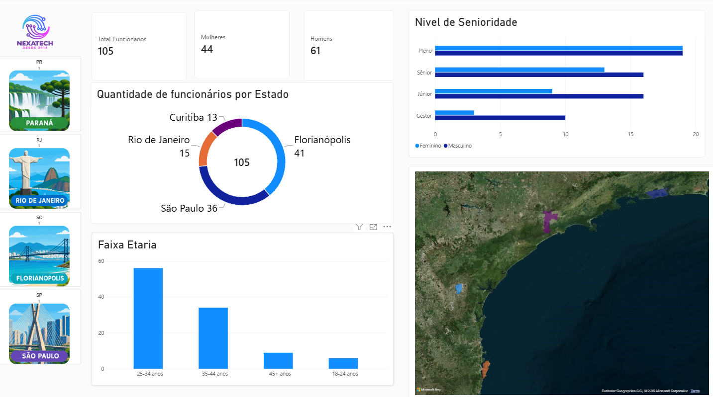
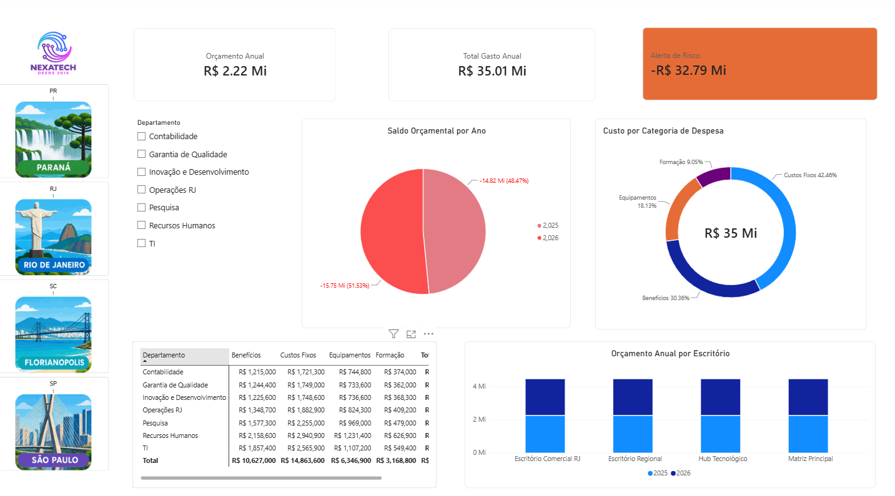
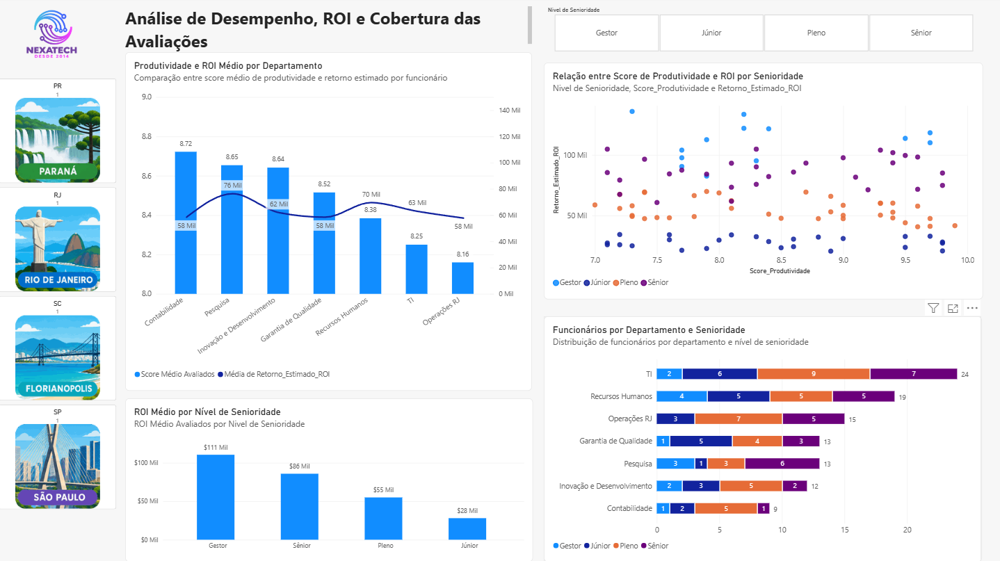

# Employee Analytics & Business Performance

**End-to-End Data Analytics Project | TOTI – Class 59**

## About the Project

This collaborative academic project focuses on analyzing employee performance, departmental ROI, productivity, and organizational costs to identify business improvement opportunities through data analysis.

## Business Objective

Analyze organizational metrics to identify strengths, improvement opportunities, and support better resource allocation and business decisions.

## Tools & Technologies

- **SQLite:** Database management and SQL queries.
- **DBeaver:** Database administration.
- **Python:** Data processing and analysis.
- **Pandas:** Data manipulation and transformation.
- **Google Colab:** Python development environment.
- **Power BI:** Data modeling, visualization, and interactive dashboards.

## Project Workflow

1. **Data Preparation:** Enrichment of the initial database with synthetic data.
2. **SQL:** Database organization and querying using SQLite and DBeaver.
3. **Python:** Data processing and modeling using Pandas in Google Colab.
4. **Power BI:** Development of interactive dashboards and performance indicators.
5. **Business Insights:** Analysis of results and identification of improvement opportunities.

## Key Areas of Analysis

- Employee performance.
- ROI by department.
- Productivity by seniority level.
- Organizational costs and expenses.
- Workforce indicators.

## My Contribution

Focused on identifying improvement opportunities in departmental ROI and analyzing employee performance by seniority level, contributing to the interpretation and presentation of business insights.

## Project Files

- `Employee_Analytics_TOTI.pbix` – Power BI dashboard.

SQL scripts and Python notebooks will be added as they become available.

## Data Disclaimer

The project uses an initial database enriched with synthetic data for academic analysis and demonstration purposes.

---

**Project Type:** Collaborative Academic Project  
**Institution:** TOTI – Data Analytics Program, Class 59  
**Technologies:** SQLite | Python | Pandas | Power BI

---

## Dashboard Preview

### 1. Workforce Overview
Employee demographics, geographic distribution, age groups, and seniority levels.

### 2. Financial & Budget Analysis
Annual budget, organizational expenses, cost categories, and departmental spending.

### 3. Performance & ROI Analysis
Departmental productivity, average ROI by seniority level, and employee performance indicators.

---

## Key Takeaways

The project provides an overview of workforce composition, organizational expenses, and employee performance, helping identify potential improvement opportunities through data analysis.
